# NammaMart Quick Commerce — Submission

**Student:** Ravi Chandrika
**Assignment:** IIT Roorkee FDAIE Module 2 — ETL & ELT Pipeline

---

## Part 0: Data Profiling & Issues Log

Profiling was performed using `include/profile_nammamart.py`. Full output saved in `profile_output.txt`.

### Data Issues Log (Summary)

| File | Issue | Column(s) | Dimension | Severity | Count |
|---|---|---|---|---|---|
| orders.csv | Missing values | order_ts(1), customer_id(18), delivery_minutes(164) | Completeness | Critical | 183 |
| orders.csv | Duplicate order_ids | order_id | Uniqueness | Critical | 12 duplicate IDs (24 rows) |
| orders.csv | Negative quantity | quantity | Accuracy | Critical | present |
| orders.csv | Discount > 100% | discount_pct | Validity | Critical | up to 250 |
| orders.csv | Future timestamps | order_ts | Timeliness | Critical | dates in 2027 |
| orders.csv | Unparseable timestamps | order_ts | Validity | Critical | 5 |
| orders.csv | Invalid statuses | order_status | Validity | Critical | 'Pending??', 'delivered' |
| orders.csv | Invalid payment modes | payment_mode | Validity | Warning | 'Cashh', 'cod', 'upi', 'CARD' |
| orders.csv | Extreme delivery times | delivery_minutes | Accuracy | Warning | up to 1440 min |
| orders.csv | Negative order_amount | order_amount | Accuracy | Critical | present |
| payments.csv | Missing gateway_ref | gateway_ref | Completeness | Warning | 301 |
| payments.csv | Duplicate payment_ids | payment_id | Uniqueness | Critical | 4 duplicate IDs (8 rows) |
| payments.csv | Future timestamps | payment_ts | Timeliness | Critical | dates in 2027 |
| payments.csv | Payment mode casing | payment_mode | Consistency | Warning | mixed casing |
| customers.csv | Missing city | city | Completeness | Warning | 6 |
| customers.csv | Duplicate customer_ids | customer_id | Uniqueness | Critical | 5 duplicate IDs (10 rows) |
| customers.csv | Future signup dates | signup_date | Timeliness | Critical | dates in 2027 |
| customers.csv | Inconsistent loyalty_tier | loyalty_tier | Consistency | Warning | 'BRONZE','Bronze','bronze','SILVER','Silver' |
| products.csv | Missing category | category | Completeness | Warning | 3 |
| products.csv | Duplicate product_ids | product_id | Uniqueness | Critical | 2 duplicate IDs (4 rows) |
| products.csv | Negative MRP | mrp | Accuracy | Critical | -203 |
| products.csv | cost_price > mrp | cost_price, mrp | Accuracy | Warning | 5 products |
| stores.csv | Missing zone | zone | Completeness | Warning | 1 |
| stores.csv | Zero capacity | capacity_orders_per_day | Accuracy | Warning | 1 store with 0 |
| increment | CLEAN | — | — | — | 160 rows, no issues |

### Referential Integrity Issues

| Check | Unmatched Count |
|---|---|
| orders.product_id not in products | 9 |
| orders.store_id not in stores | 5 |
| payments.order_id not in orders | 8 |
| orders.customer_id not in customers | 0 |
| Order amount formula mismatches | 15 |
| SUCCESS payment amount ≠ order amount | 14 |

### 3 Questions for the Client

1. **Negative quantities:** Is a negative quantity a return/refund or a data-entry error? Currently we quarantine them as critical failures.
2. **Discount > 100%:** Are discounts above 100% promotional credits (e.g., loyalty rewards) or data errors? This affects revenue calculations.
3. **Delivery time outliers:** The 120-minute cap is the current threshold — should we adjust it? Some legitimate deliveries in traffic-heavy zones may exceed 60 minutes.

---

## Part A: ETL Pipeline

### Files

| File | Purpose |
|---|---|
| `dags/nammamart_etl_chandrika.py` | Main ETL DAG — 18 tasks, 8 phases |
| `include/transform_nammamart.py` | Star schema transformations (pandas) |
| `include/ai_explainer_nammamart.py` | AI-powered failure explanation (optional, graceful fallback) |
| `include/quality_checks_nammamart.py` | Technical DQ checks (completeness, uniqueness, validity) |
| `include/business_rules_check_nammamart.py` | Business rule checks (accuracy, consistency, timeliness) |
| `include/extract_nammamart.py` | CSV extraction for 5+1 datasets |
| `include/slack_notifier_nammamart.py` | Slack alerts on failure |

### DAG Flow (8 Phases, 18 Tasks)

```
Phase 1 — EXTRACT (parallel)
  extract_orders, extract_payments, extract_customers, extract_products, extract_stores
      │
Phase 2 — VALIDATE
  validate_data_quality → write_dq_results
      │
Phase 3 — QUARANTINE + AI + ALERT
  quarantine_failed_records → ai_explain_failures → slack_alert_on_failures
      │
Phase 4 — TRANSFORM
  transform_passed_records  (star schema: fact + 3 dims)
      │
Phase 5 — LOAD
  load_to_warehouse  (DuckDB: etl_fact_orders, etl_dim_customer/product/store)
      │
Phase 6 — RECONCILE
  reconcile_payments  (etl_payment_reconciliation)
      │
Phase 7 — REPORT
  build_reports  (etl_daily_zone_revenue, etl_category_margin)
      │
Phase 8 — AUDIT (trigger_rule=ALL_DONE)
  write_run_audit  (pipeline_runs table)
```
### ETL Graph view with all green tasks
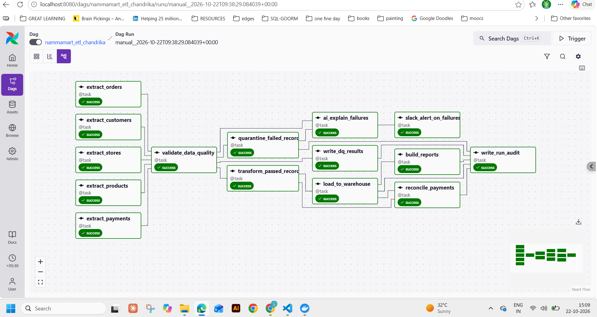

### Key Design Decisions

- **Idempotent loads:** Fact and dimension tables use `CREATE OR REPLACE`. Reconciliation uses `DELETE WHERE run_id` then INSERT.
- **PII masking in Python:** Email masked to `p***@domain.com`, phone to `******4321` before warehouse load.
- **Quarantine:** Failed rows written to `include/quarantine/nammamart/<run_id>/` as CSV with `_failure_reasons` column.
- **DQ results:** Every check logged to `dq_results` table with dimension, severity, rows_checked, rows_failed.
- **Star schema:** `etl_fact_orders` + `etl_dim_customer` + `etl_dim_product` + `etl_dim_store`.
- **AI explainer:** Uses LangGraph (optional) — wrapped in `try/except ImportError` so pipeline works without it.
- **DuckDB lock handling:** `time.sleep(5)` + `retries=3, retry_delay=15s` for concurrent access.

### Tables created in NammaMart DuckDB warehouse
After initial run, [('dq_results',), ('etl_category_margin',), ('etl_daily_zone_revenue',), ('etl_dim_customer',), ('etl_dim_product',), ('etl_dim_store',), ('etl_fact_orders',), ('etl_payment_reconciliation',), ('pipeline_runs',)] are created in the warehouse_chandrika.duckdb

### Initial Run: Details for tables in NammaMart DuckDB warehouse inside the running Airflow scheduler container. 
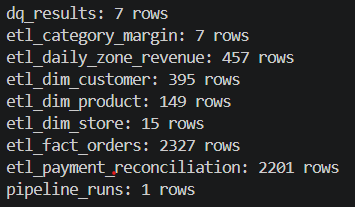

### Incremental Run: Details for tables in NammaMart DuckDB warehouse inside the running Airflow scheduler container. 
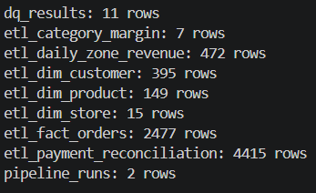


### Warehouse Validation: Initial vs Incremental Run

| Table Name | Initial Run | Incremental Run | Change |
|---|---:|---:|---:|
| `dq_results` | 7 | 11 | +4 |
| `etl_category_margin` | 7 | 7 | 0 |
| `etl_daily_zone_revenue` | 457 | 472 | +15 |
| `etl_dim_customer` | 395 | 395 | 0 |
| `etl_dim_product` | 149 | 149 | 0 |
| `etl_dim_store` | 15 | 15 | 0 |
| `etl_fact_orders` | 2,327 | 2,477 | +150 |
| `etl_payment_reconciliation` | 2,201 | 4,415 | +2,214 |
| `pipeline_runs` | 1 | 2 | +1 |

**Summary:** 
The incremental run added 150 rows to `etl_fact_orders` and created a second pipeline audit record. Dimension table counts remained unchanged. The daily zone revenue and data-quality tables increased, while payment reconciliation grew by 2,214 rows. These row counts demonstrate changes between runs but do not independently confirm data correctness or idempotency.

---

## Part B: ELT Pipeline

### Files

| File | Purpose |
|---|---|
| `dags/nammamart_elt_chandrika.py` | Main ELT DAG — 6 tasks, 5 phases |
| `include/sql/01_create_raw.sql` | Raw table creation (idempotent) |
| `include/sql/02_create_staging.sql` | Staging transforms: cast, dedupe, mask PII, DQ flags |
| `include/sql/03_create_marts.sql` | Mart tables answering 6 business questions |
| `include/sql/04_incremental_orders.sql` | Incremental merge for the Oct 1 file |

### DAG Flow (5 Phases, 6 Tasks)

```
Phase 1 — LOAD RAW
  load_raw_data  (CSVs → raw_* tables, all VARCHAR, no cleaning)
      │
Phase 2 — STAGING
  run_staging_sql  (02_create_staging.sql → stg_* with DQ flags)
      │
Phase 3 — MARTS
  run_marts_sql  (03_create_marts.sql → mart_* aggregates)
      │
Phase 4 — INCREMENTAL (skipped on initial run)
  run_incremental_merge → rebuild_marts_after_merge
      │
Phase 5 — AUDIT (trigger_rule=ALL_DONE)
  write_elt_audit  (pipeline_runs table)
```
### ELT Graph view with all green tasks

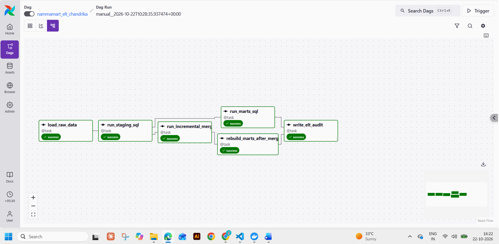

### Three-Layer Architecture

| Layer | Tables | Rule |
|---|---|---|
| **Raw** | `raw_orders`, `raw_payments`, `raw_customers`, `raw_products`, `raw_stores` | Exact CSV copy, all VARCHAR, plus `_loaded_at`, `_source_file`, `_run_id`. Never cleaned. |
| **Staging** | `stg_orders`, `stg_payments`, `stg_customers`, `stg_products`, `stg_stores` | SQL-only: TRY_CAST, dedupe (ROW_NUMBER), PII masking, value standardisation, `dq_status` + `failure_reason` |
| **Mart** | `mart_daily_zone_revenue`, `mart_category_margin`, `mart_delivery_sla`, `mart_payment_reconciliation`, `mart_top_customers`, `mart_elt_dq_summary` | Aggregates from PASS rows only |

### Key Design Decisions

- **Raw tables dynamically created** from CSV headers (`DROP + CREATE TABLE AS SELECT`) — no schema mismatch risk.
- **PII masking in SQL:** `SUBSTR(email,1,1)||'***'||SUBSTR(email,POSITION('@' IN email))` and `REPEAT('*',LENGTH(phone)-4)||SUBSTR(phone,LENGTH(phone)-3)`.
- **Incremental merge:** `DELETE + INSERT` on `order_id` in `stg_orders` from the increment file.
- **Marts rebuilt** after merge to reflect updated data.
- **DQ in SQL:** Each staging table has `dq_status` (PASS/FAIL/WARN) and `failure_reason`.

### Table list showing the actual tables in warehouse_chandrika.duckdb warehouse.

After the ELT Run few other tables are created in the warehouse_chandrika.duckdb if it is not cleanded before ELT run.
ELT is using separate raw/staging/mart tables.

[('dq_results',), ('etl_category_margin',), ('etl_daily_zone_revenue',), ('etl_dim_customer',), ('etl_dim_product',), ('etl_dim_store',), ('etl_fact_orders',), ('etl_payment_reconciliation',), ('mart_category_margin',), ('mart_daily_zone_revenue',), ('mart_delivery_sla',), ('mart_elt_dq_summary',), ('mart_payment_reconciliation',), ('mart_top_customers',), ('pipeline_runs',), ('raw_customers',), ('raw_orders',), ('raw_payments',), ('raw_products',), ('raw_stores',), ('stg_customers',), ('stg_orders',), ('stg_payments',), ('stg_products',), ('stg_stores',)]

### Initial Run: Tables created and number of rows in NammaMart DuckDB warehouse after ELT Initial run

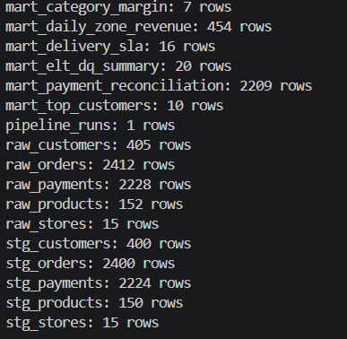

### Incremental Run: Tables created and number of rows in NammaMart DuckDB warehouse after ELT Incremental run
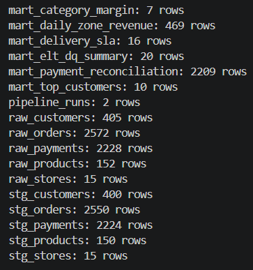


### ELT Warehouse Validation: Initial vs Incremental Run

| Table Name | Initial Run | Incremental Run | Change |
|---|---:|---:|---:|
| `mart_category_margin` | 7 | 7 | 0 |
| `mart_daily_zone_revenue` | 454 | 469 | +15 |
| `mart_delivery_sla` | 16 | 16 | 0 |
| `mart_elt_dq_summary` | 20 | 20 | 0 |
| `mart_payment_reconciliation` | 2,209 | 2,209 | 0 |
| `mart_top_customers` | 10 | 10 | 0 |
| `pipeline_runs` | 1 | 2 | +1 |
| `raw_customers` | 405 | 405 | 0 |
| `raw_orders` | 2,412 | 2,572 | +160 |
| `raw_payments` | 2,228 | 2,228 | 0 |
| `raw_products` | 152 | 152 | 0 |
| `raw_stores` | 15 | 15 | 0 |
| `stg_customers` | 400 | 400 | 0 |
| `stg_orders` | 2,400 | 2,550 | +150 |
| `stg_payments` | 2,224 | 2,224 | 0 |
| `stg_products` | 150 | 150 | 0 |
| `stg_stores` | 15 | 15 | 0 |

**Summary:** 
The initial ELT run created the raw, staging, and mart tables and recorded one pipeline execution. The incremental run increased `raw_orders` by 160 rows and `stg_orders` by 150 rows, while `mart_daily_zone_revenue` grew by 15 rows. The `pipeline_runs` table increased from one to two records, confirming that both executions were recorded. All other table row counts remained unchanged.
These results demonstrate changes in warehouse row counts between the two runs. Further checks of record contents and duplicate handling would be needed to confirm data correctness and idempotency.

### Image showing run IDs, DAG IDs, row counts and run status for pipelines.

**For ETL** 

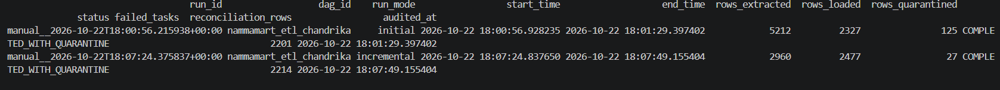

**For ELT**

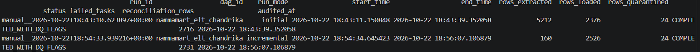

---

### No errors in Dag
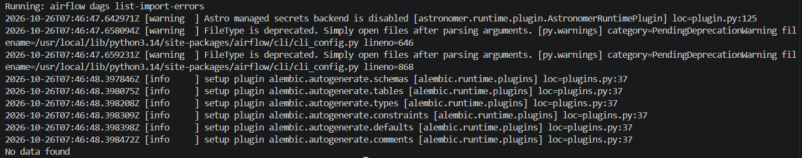

---

## Part C: Scheduling Answers

**1. Cron expression:**
`0 9 * * 1-6` — runs at 9:00 AM every Monday through Saturday.
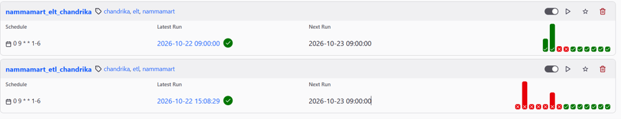

### ETL CRON Scheduler timings
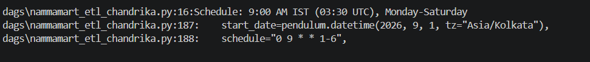

### ELT CRON Scheduler timings
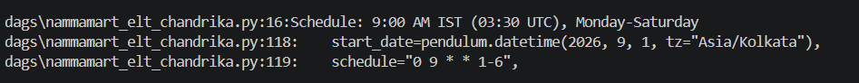

**2. UTC display in Airflow UI:**
The run shows as **03:30 UTC** in the Airflow UI. IST is UTC+5:30, so 9:00 AM IST = 3:30 AM UTC.

**3. What would happen if start_date were in UTC?**
If we used `start_date=datetime(2026, 9, 1)` without a timezone, Airflow interprets it as UTC. The DAG would run at 9:00 AM UTC = 2:30 PM IST — five and a half hours after the leadership stand-up. The reports would miss the 9:30 AM SLA entirely.

**4. What happens if Docker is off at 9 AM?**
With `catchup=False`, the missed scheduled run is skipped. When Docker restarts, only the next scheduled run fires. This is correct for NammaMart: we want today’s fresh data, not a backlog of stale runs. If we needed to reprocess, we can manually trigger with the appropriate `run_mode`.

---

## Part D: Data Quality Dimensions

### Coverage Matrix

| Dimension | ETL (Python) | ELT (SQL) | Example Check |
|---|---|---|---|
| **Completeness** | `quality_checks_nammamart.py` — null checks on required fields | `02_create_staging.sql` — CASE WHEN col IS NULL THEN 'FAIL' | `customer_id` NOT NULL in orders; `delivery_minutes` present for DELIVERED |
| **Uniqueness** | `quality_checks_nammamart.py` — duplicate key detection | `02_create_staging.sql` — ROW_NUMBER() deduplication | `order_id` unique; `payment_id` unique |
| **Validity** | `quality_checks_nammamart.py` — allowed-value lists, format checks | `02_create_staging.sql` — CASE checks on status, payment_mode | `order_status` in (DELIVERED, CANCELLED, RETURNED); `discount_pct` 0–100 |
| **Accuracy** | `business_rules_check_nammamart.py` — formula verification, range checks | `02_create_staging.sql` — calculated_order_amount vs source, quantity > 0 | `order_amount` matches formula; `mrp > 0`; `quantity > 0` |
| **Consistency** | `business_rules_check_nammamart.py` — referential integrity, casing | `02_create_staging.sql` — loyalty_tier standardised; payment_mode mapped | `customer_id` exists in customers; `loyalty_tier` Title Case |
| **Timeliness** | `business_rules_check_nammamart.py` — future-date detection | `02_create_staging.sql` — order_ts/signup_date not > CURRENT_DATE | No future `order_ts`; no future `signup_date` |

### Severity Rules

| Severity | Action | Examples |
|---|---|---|
| **Critical** | Quarantined (ETL) / `dq_status = 'FAIL'` (ELT) — excluded from marts | NULL order_id, NULL customer_id, negative quantity, future dates, duplicate keys |
| **Warning** | Loaded but logged — visible in `dq_results` / `dq_status = 'WARN'` | Missing gateway_ref, missing city, zero-capacity store, extreme delivery time |

### DQ Results Table Schema

```sql
CREATE TABLE dq_results (
    run_id       VARCHAR,
    dag_id       VARCHAR,
    check_name   VARCHAR,
    dimension    VARCHAR,
    severity     VARCHAR,
    rows_checked INTEGER,
    rows_failed  INTEGER,
    status       VARCHAR,
    checked_at   TIMESTAMP
);
```

Populated every run by both pipelines. Accumulates across runs for trend analysis.

### DQ Results for ETL Pipeline

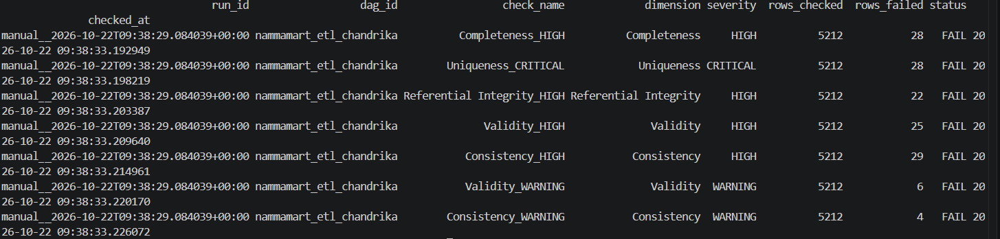

### DQ Results for ELT Pipeline

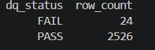

---

## Part E: Data Governance Answers

### E.1 Ownership

| Dataset | Owner | Rationale |
|---|---|---|
| orders.csv, payments.csv | **Ops & Finance team** | These are transactional facts from the order management and payment gateway systems |
| customers.csv | **CRM team** | Contains PII; CRM team controls customer data lifecycle |
| products.csv | **Catalogue/Merchandising team** | Product master maintained by the catalogue team |
| stores.csv | **Operations team** | Store master with capacity and zone data |
| Warehouse tables (etl_*, stg_*, mart_*) | **Data Engineering team (FDE)** | Pipeline-generated; FDE owns schema and quality |

**Quality rule changes** (e.g., the 120-minute delivery limit): The ops team proposes the threshold, the data engineering team implements and tests it, and the change is approved by the COO (Kavya) since it affects the daily operations review. Changes should be version-controlled and deployed through the DAG code.

### E.2 Data Dictionary

#### etl_fact_orders (Fact Table)

| Column | Type | Meaning | Source | Allowed Values | PII |
|---|---|---|---|---|---|
| order_id | VARCHAR | Unique order identifier | orders.csv | Non-null, unique | No |
| order_ts | TIMESTAMP | Order creation timestamp | orders.csv | Valid timestamp, not future | No |
| order_date | DATE | Date extracted from order_ts | Derived | Valid date | No |
| customer_id | VARCHAR | FK to etl_dim_customer | orders.csv | Must exist in customers | No |
| store_id | VARCHAR | FK to etl_dim_store | orders.csv | Must exist in stores | No |
| product_id | VARCHAR | FK to etl_dim_product | orders.csv | Must exist in products | No |
| quantity | INTEGER | Units ordered | orders.csv | > 0 | No |
| unit_price | DOUBLE | Price per unit | orders.csv | > 0 | No |
| discount_pct | DOUBLE | Discount percentage applied | orders.csv | 0–100 | No |
| order_amount | DOUBLE | Original order amount from source | orders.csv | >= 0 | No |
| calculated_order_amount | DOUBLE | qty × unit_price × (1 − discount/100) | Derived | >= 0 | No |
| net_revenue | DOUBLE | Revenue for DELIVERED orders, else 0 | Derived | >= 0 | No |
| gross_margin | DOUBLE | net_revenue − (qty × cost_price) | Derived | Can be negative | No |
| within_15_min | BOOLEAN | True if delivery_minutes ≤ 15 | Derived | True/False | No |
| payment_mode | VARCHAR | Standardised payment method | orders.csv | UPI, CARD, CASH, WALLET | No |
| order_status | VARCHAR | Standardised order status | orders.csv | DELIVERED, CANCELLED, RETURNED, PENDING, SHIPPED | No |
| channel | VARCHAR | Order channel | orders.csv | Free text | No |
| delivery_minutes | DOUBLE | Minutes to deliver | orders.csv | 8–1440 (>120 flagged) | No |

#### etl_dim_customer (Dimension)

| Column | Type | Meaning | Source | PII |
|---|---|---|---|---|
| customer_id | VARCHAR | Primary key | customers.csv | No |
| full_name | VARCHAR | Customer name | customers.csv | Yes |
| masked_email | VARCHAR | Email with local part masked (e.g., p***@example.com) | Derived from email | No (masked) |
| masked_phone | VARCHAR | Phone with all but last 4 digits masked | Derived from phone | No (masked) |
| city | VARCHAR | Customer city | customers.csv | No |
| area | VARCHAR | Customer area | customers.csv | No |
| loyalty_tier | VARCHAR | Title-cased loyalty tier | customers.csv | No |

#### etl_dim_product (Dimension)

| Column | Type | Meaning | Source | PII |
|---|---|---|---|---|
| product_id | VARCHAR | Primary key | products.csv | No |
| product_name | VARCHAR | Product name (non-old preferred) | products.csv | No |
| category | VARCHAR | Product category | products.csv | No |
| sub_category | VARCHAR | Product sub-category | products.csv | No |
| brand | VARCHAR | Brand name | products.csv | No |
| mrp | DOUBLE | Maximum retail price | products.csv | No |
| cost_price | DOUBLE | Cost to NammaMart | products.csv | No |

#### etl_dim_store (Dimension)

| Column | Type | Meaning | Source | PII |
|---|---|---|---|---|
| store_id | VARCHAR | Primary key | stores.csv | No |
| store_name | VARCHAR | Store display name | stores.csv | No |
| zone | VARCHAR | Delivery zone (North/South/East/West) | stores.csv | No |
| area | VARCHAR | Store area | stores.csv | No |
| capacity_orders_per_day | INTEGER | Max orders the store can handle | stores.csv | No |

### E.3 Lineage

**Tracing a number from mart_daily_zone_revenue back to source:**

Take `total_net_revenue` for zone=“North” on 2026-09-15.

**ETL lineage:** `etl_daily_zone_revenue` ← `build_reports` task ← `etl_fact_orders` (WHERE order_status=‘DELIVERED’ AND order_date=‘2026-09-15’) joined with `etl_dim_store` (WHERE zone=‘North’) ← `load_to_warehouse` task ← `transform_passed_records` (derived net_revenue) ← `validate_data_quality` (passed rows only) ← `extract_orders` ← `orders.csv` specific rows. The quarantined rows that were excluded can be found in `include/quarantine/nammamart/<run_id>/orders_quarantine.csv` with their `_failure_reasons`.

**ELT lineage:** `mart_daily_zone_revenue` ← `03_create_marts.sql` ← `stg_orders` (WHERE dq_status=‘PASS’ AND order_status=‘DELIVERED’) joined with `stg_stores` ← `02_create_staging.sql` ← `raw_orders` (all rows preserved) ← `orders.csv`. Failed rows are visible in `stg_orders` with `dq_status=‘FAIL’` and `failure_reason` explaining why.

**Which is easier?** ELT is easier to trace because every layer is a SQL table in the same warehouse. You can query `raw_orders` to see the exact source data, `stg_orders` to see the DQ flag, and `mart_daily_zone_revenue` for the final number — all with SQL. In ETL, the quarantine data is in CSV files on disk, requiring file system access alongside database queries.

### E.4 Personal Data

**PII columns in the dataset:**

| File | Column | PII Type |
|---|---|---|
| customers.csv | full_name | Name |
| customers.csv | email | Email address |
| customers.csv | phone | Phone number |
| stores.csv | manager_name | Name |

**Masking approach:**
- Email: `p***@example.com` — first character of local part + `***` + domain
- Phone: `******4321` — all digits masked except last 4
- full_name and manager_name: kept as-is in dimension tables (not exposed in mart/reporting tables)

**Why mask rather than delete?** Masking preserves referential utility — the ops team can still identify patterns (e.g., “same email domain” or “same area code”) without seeing the full PII. Deletion would break joins and make customer analysis impossible.

**Applicable Indian law:** The **Digital Personal Data Protection Act, 2023 (DPDPA)** applies to NammaMart’s customer data. It requires: (1) lawful purpose for processing personal data, (2) consent or legitimate use, (3) data minimisation, (4) reasonable security safeguards, (5) breach notification to the Data Protection Board. NammaMart must ensure customer data is processed only for operational purposes, masked in reporting, and retained only as long as necessary.

### E.5 Access Control

| Table Layer | Who Should Read | Rationale |
|---|---|---|
| Raw (`raw_*`) | Data engineers, compliance/audit | Contains unmasked PII; restricted access |
| Staging (`stg_*`) | Data engineers, senior analysts | PII masked; DQ flags visible for debugging |
| Mart (`mart_*`) | All business users (COO, store managers, finance) | Clean, aggregated, no PII |
| Quarantine files | Data engineers, data quality team | Contains raw failed rows for investigation |
| `raw_customers` (unmasked phone/email) | **Only** the CRM team lead and data engineers with a documented business need | PII access must be logged and auditable |

### E.6 Retention

| Data | Retention Period | After Expiry |
|---|---|---|
| Raw data (`raw_*` tables) | 7 years | Archive to cold storage, then delete. Required for financial audit trails |
| Quarantine files (CSVs) | 90 days | Delete. Failed rows are for debugging, not long-term storage |
| Masked customer data (dimensions) | As long as the customer relationship exists + 3 years | Anonymise or delete per DPDPA right-to-erasure requests |
| Mart tables | Rebuilt each run | No retention concern; always reflects current staging data |
| `pipeline_runs` / `dq_results` | 2 years | Archive. Useful for observability trend analysis |

### E.7 Secrets

Credentials like `SLACK_WEBHOOK_URL` are stored in **Airflow Variables** (accessed via `Variable.get("SLACK_WEBHOOK_URL")`). The DAG code reads the variable at runtime.

**Why never in the DAG file or on GitHub:**
1. DAG files are version-controlled in Git — a webhook URL in code would be visible to anyone with repo access, including in Git history even after deletion.
2. Webhook URLs grant the ability to post messages to a Slack channel — a leaked URL enables phishing or spam.
3. Airflow Variables are stored in the Airflow metadata database with access restricted to the Airflow admin. They can be rotated without a code change or redeployment.

### E.8 Audit Trail for a Rejected Order

**Finance asks:** “Pick any order that was rejected. Show it exactly as received, the rule it broke, and prove it isn’t in the CFO’s revenue total.”

**ETL pipeline answer:**
1. **As received:** Open `include/quarantine/nammamart/<run_id>/orders_quarantine.csv`. Find the row by `order_id`. The `_failure_reasons` column shows the exact rule(s) broken.
2. **Rule it broke:** Cross-reference with `dq_results` table: `SELECT * FROM dq_results WHERE run_id = '<run_id>'` shows aggregated DQ findings.
3. **Not in revenue:** `SELECT COUNT(*) FROM etl_fact_orders WHERE order_id = '<rejected_order_id>'` returns 0. The row was quarantined before loading.

**ELT pipeline answer:**
1. **As received:** `SELECT * FROM raw_orders WHERE order_id = '<rejected_order_id>'` — the exact source row, untouched.
2. **Rule it broke:** `SELECT dq_status, failure_reason FROM stg_orders WHERE order_id = '<rejected_order_id>'` — shows `FAIL` and the specific reason.
3. **Not in revenue:** `SELECT * FROM mart_daily_zone_revenue` only includes rows WHERE `dq_status = 'PASS'`. The rejected order’s `dq_status = 'FAIL'` excludes it from all marts.

### E.9 Change History (DELIVERED → RETURNED)

**Scenario:** Order ORD-1234 was DELIVERED on 3 September. On 1 October, the increment file changes its status to RETURNED.

**ETL pipeline:** After the incremental run, `etl_fact_orders` shows ORD-1234 with `order_status = 'RETURNED'` and `net_revenue = 0`. September revenue **decreases** because the DELETE+INSERT upsert replaced the old row. The ETL pipeline shows the **current truth** — this order is no longer revenue.

**ELT pipeline:** After the incremental merge, `stg_orders` shows ORD-1234 with `order_status = 'RETURNED'`. The mart tables reflect the updated status. However, `raw_orders` preserves **both** the original DELIVERED row (from the initial load) and the RETURNED row (from the increment), with different `_run_id` values. This provides a full audit trail.

**Which answer does finance want?** Finance wants the **corrected** September revenue (excluding the return) for the official P&L. However, they also want to understand the adjustment. The ELT approach serves both needs: the mart shows corrected numbers, while raw preserves the history for audit. The ETL approach gives the correct current number but loses the “before” state unless you check the quarantine or staging files from the original run.

**Keeping both views:** To provide both, implement SCD Type 2 on the fact table (add `valid_from`, `valid_to` columns) or maintain a separate `order_status_history` table. The ELT raw layer already provides this naturally.

---

## Part G: Recommendation to the Client

### Memo to Sameer (CTO, NammaMart)

**Subject: ETL or ELT — Recommendation for NammaMart’s Data Pipeline**

Sameer,

After building and testing both pipelines side by side on the same September dataset, here is my recommendation.

**Recommendation: Adopt ELT as the primary pipeline, with ETL-style guardrails for finance-critical tables.**

#### Evidence from Our Pilot

| Criterion | ETL | ELT | Winner |
|---|---|---|---|
| **Auditability** | Quarantine files on disk + warehouse tables. Tracing requires file system + DB access. | Every row in `raw_*`, DQ flags in `stg_*`, clean data in `mart_*`. All queryable with SQL. | ELT |
| **Data quality guarantee** | Bad rows never reach the warehouse. Finance sees only validated data. | Bad rows are in raw/staging with `dq_status=FAIL`. Marts filter to `PASS` only. Same guarantee, different mechanism. | Tie |
| **Ease of change** | Adding a check means modifying Python code, redeploying the DAG, and restarting Airflow. | Adding a check means editing a SQL file. No DAG change, no restart. | ELT |
| **Debugging** | Must correlate CSV quarantine files with task logs and warehouse tables. | All data in one place: `raw_orders → stg_orders → mart_*`. One SQL session. | ELT |
| **Incremental loads** | Python DELETE+INSERT works but loses the “before” state. | Raw preserves every version. Staging MERGE handles corrections. Full history. | ELT |
| **Performance at 1000× scale** | pandas operates in single-node memory. At 2.4M orders/month, pandas would require chunking or migration to Spark. | DuckDB handles analytical SQL efficiently on a single node up to ~100M rows. Beyond that, migrate the same SQL to a cloud warehouse (Snowflake, BigQuery, Databricks SQL). | ELT |
| **Cost** | DuckDB + Airflow (open source, free). pandas at scale needs larger machines. | DuckDB + Airflow (open source, free). SQL is portable to any cloud warehouse. | Tie |

#### Why Not Pure ETL?

ETL works perfectly for NammaMart’s current scale (2,400 orders/month). But it has three structural limitations:

1. **No raw audit trail.** Once a row fails validation, it goes to a CSV file on disk. If that file is lost or the disk fills up, the audit trail is gone.
2. **Python-bound transformations.** Every new business rule requires Python code changes, testing, and DAG redeployment. SQL changes in ELT are simpler and faster.
3. **Scale ceiling.** pandas processes data in memory on a single machine. At 1,000× NammaMart’s current volume, this breaks. ELT’s SQL transforms run inside the database engine, which is designed for exactly this.

#### Top 3 Risks of the Recommended ELT Design

1. **Raw table growth.** ELT keeps every row forever. Without a retention policy and archival process, `raw_*` tables will grow indefinitely. **Mitigation:** Implement a 7-year retention policy with automated archival to cold storage.

2. **SQL complexity for advanced transforms.** Some transformations (e.g., complex PII masking, ML-based anomaly detection) are harder to express in SQL. **Mitigation:** Use Python-based Airflow tasks for complex transforms that feed back into the warehouse, keeping a hybrid approach where needed.

3. **DuckDB is single-node.** DuckDB is excellent for NammaMart’s current scale but cannot horizontally scale. If NammaMart grows to millions of daily orders, the warehouse engine must migrate. **Mitigation:** Write standard SQL that is portable to cloud warehouses. The migration would change the connection string, not the business logic.

#### Final Word

For NammaMart today: **ELT with DuckDB.** It’s simpler to operate, easier to audit, and the SQL is portable when you outgrow a single machine. Keep the ETL pipeline as a reference for the finance team’s strict “no-bad-rows” requirement — but serve daily operations from the ELT marts.

Ravi Chandrika
Forward Deployed Engineer

---

## Part F: Observability Tests

*(To be completed after running the 10 experiments)*

| # | Experiment | Expected | Observed | Where I Saw It | What I Would Change |
|---|---|---|---|---|---|
| 1 | Happy path | All tasks green, data loaded | | | |
| 2 | Re-run (idempotency) | Fact rows don’t change | | | |
| 3 | Incremental load | 150 inserted, 10 updated | | | |
| 4 | Missing source file | Task fails with retry, alert | | | |
| 5 | New bad data | Bad rows quarantined with reasons | | | |
| 6 | Schema change | Task fails loudly | | | |
| 7 | Volume anomaly | Warning if volume drops >90% | | | |
| 8 | Distribution drift | Check catches price anomaly | | | |
| 9 | Freshness | Timeliness check warns | | | |
| 10 | Recovery | Only failed + downstream re-run | | | |

### Five Pillars of Data Observability

| Pillar | Coverage in Our Pipeline | Strength |
|---|---|---|
| **Freshness** | Timeliness DQ checks flag future dates and stale data. `pipeline_runs` tracks run timing. | Medium |
| **Volume** | `pipeline_runs` records `rows_extracted` and `rows_loaded`. Volume anomaly check can compare against historical averages. | Medium |
| **Schema** | Airflow task fails loudly on column mismatch (tested in experiment 6). DuckDB rejects mismatched inserts. | Strong |
| **Distribution** | DQ checks catch extreme values (negative quantities, discount >100%). No automated statistical drift detection yet. | Weakest |
| **Lineage** | ETL: staging JSON + quarantine CSVs + warehouse tables. ELT: raw → staging → mart, all in SQL. ELT lineage is stronger. | Strong (ELT) |

---

## Business Questions — SQL Queries

*(Run these on the warehouse after a successful pipeline run)*

### Q1: Daily net revenue by zone and store (DELIVERED only)
```sql
-- ETL
SELECT * FROM etl_daily_zone_revenue ORDER BY order_date, zone;
```

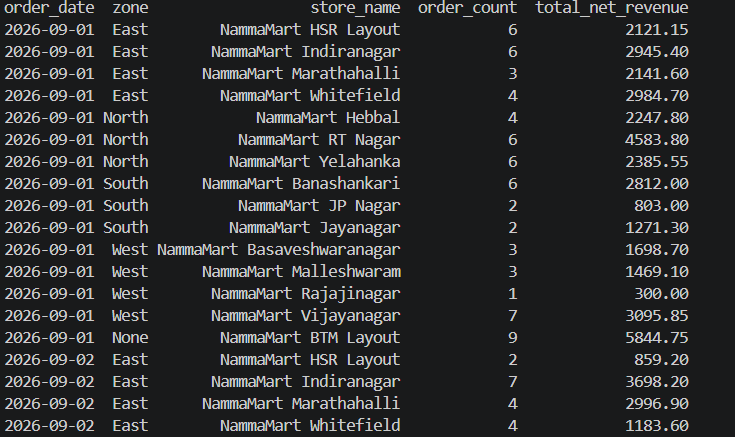

```sql
-- ELT
SELECT * FROM mart_daily_zone_revenue ORDER BY order_date, zone;
```
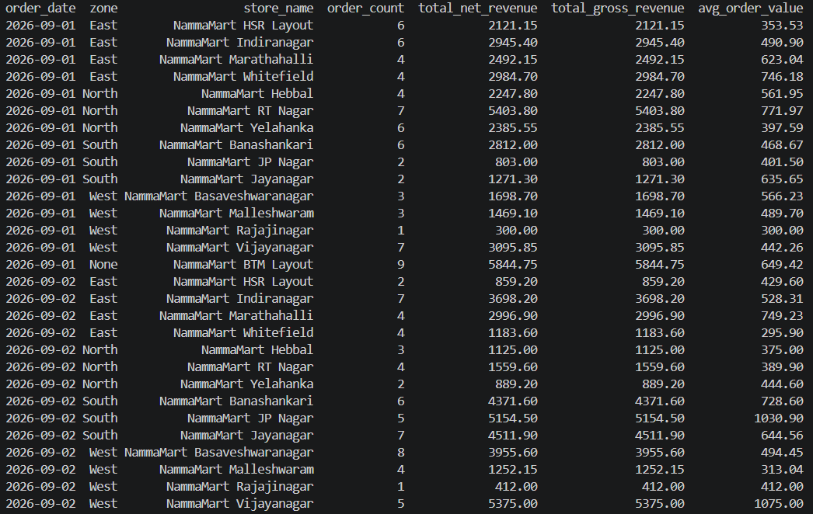


### Q2: Revenue and gross margin by category

```sql
-- ETL
SELECT * FROM etl_category_margin ORDER BY total_revenue DESC;
```

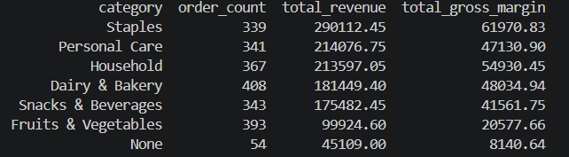

```sql
-- ELT
SELECT * FROM mart_category_margin ORDER BY total_revenue DESC;
```
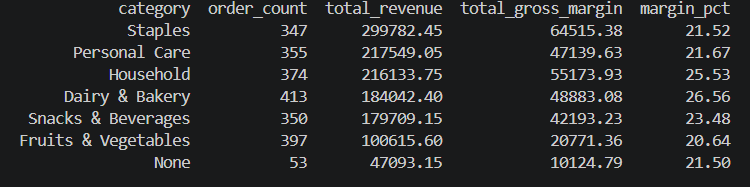

### Q3: Average delivery time per store, % within 15 min
```sql
-- ELT
SELECT * FROM mart_delivery_sla ORDER BY zone, avg_delivery_minutes;
```
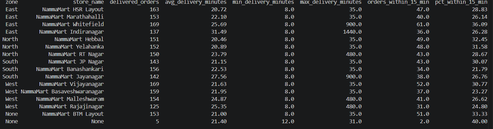

```sql
-- ETL (query directly)
SELECT s.zone, s.store_name,
       COUNT(*) AS delivered_orders,
       ROUND(AVG(f.delivery_minutes), 2) AS avg_delivery_minutes,
       ROUND(100.0 * SUM(CASE WHEN f.within_15_min THEN 1 ELSE 0 END) / COUNT(*), 2) AS pct_within_15_min
FROM etl_fact_orders f
JOIN etl_dim_store s ON f.store_id = s.store_id
WHERE f.order_status = 'DELIVERED' AND f.delivery_minutes IS NOT NULL
GROUP BY s.zone, s.store_name
ORDER BY s.zone, avg_delivery_minutes;
```
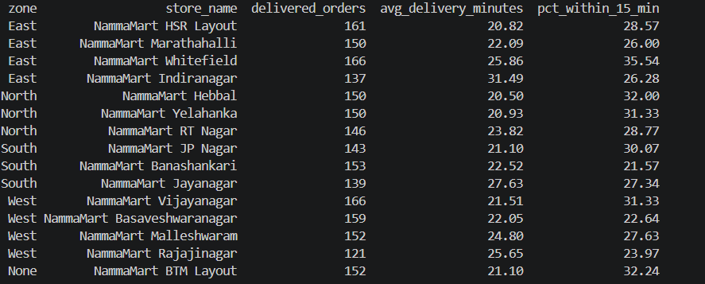

### Q4: Revenue by payment mode, unreconciled amount
```sql
-- ELT
SELECT reconciliation_status, COUNT(*) AS count,
       SUM(amount_paid) AS total_paid, SUM(order_amount) AS total_order_amount
FROM mart_payment_reconciliation
GROUP BY reconciliation_status;
```
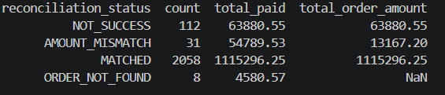

```sql
-- ETL
SELECT reconciliation_status, COUNT(*) AS count,
       SUM(amount_paid) AS total_paid, SUM(order_amount) AS total_order_amount
FROM etl_payment_reconciliation
WHERE run_id = (SELECT MAX(run_id) FROM etl_payment_reconciliation)
GROUP BY reconciliation_status;
```
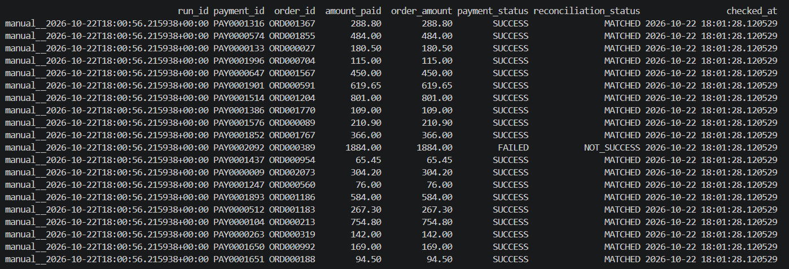
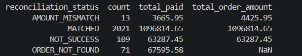

### Q5: Top 10 customers by spend (masked PII)
```sql
-- ELT
SELECT * FROM mart_top_customers;
```
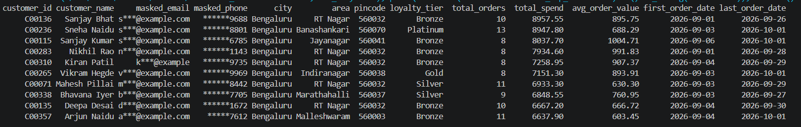

```sql
-- ETL
SELECT c.customer_id, c.masked_email, c.masked_phone, c.loyalty_tier,
       COUNT(*) AS total_orders, SUM(f.net_revenue) AS total_spend
FROM etl_fact_orders f
JOIN etl_dim_customer c ON f.customer_id = c.customer_id
WHERE f.order_status = 'DELIVERED'
GROUP BY c.customer_id, c.masked_email, c.masked_phone, c.loyalty_tier
ORDER BY total_spend DESC
LIMIT 10;
```
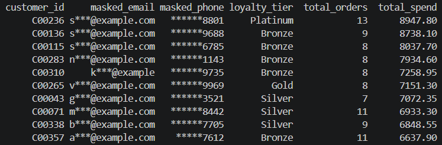

### Q6: Rows rejected today, by file and reason
```sql
-- ELT
SELECT * FROM mart_elt_dq_summary WHERE dq_status = 'FAIL' ORDER BY dataset;
```
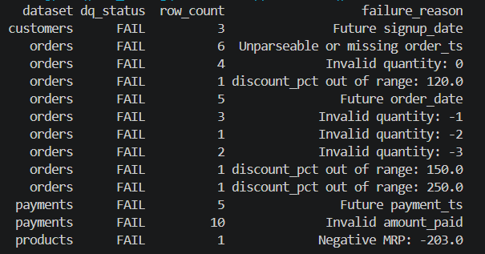

```sql
-- ETL
SELECT dimension, severity, SUM(rows_failed) AS total_failed
FROM dq_results
WHERE run_id = (SELECT MAX(run_id) FROM dq_results)
GROUP BY dimension, severity
ORDER BY total_failed DESC;
```
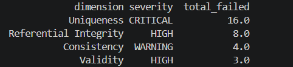

---

**Note:** `etl_payment_reconciliation`, `dq_results`, and `pipeline_runs` are audit/history tables — they accumulate across DAG runs (each run adds rows scoped by `run_id`). This is intentional for observability and run-over-run comparison. For a clean single-run count, delete `warehouse_chandrika.duckdb` and trigger one fresh `initial` run.
